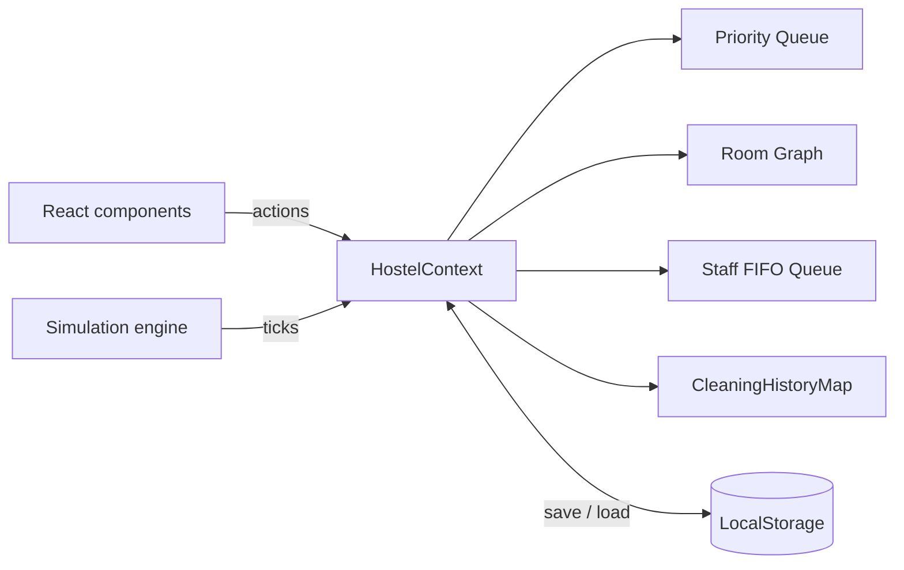
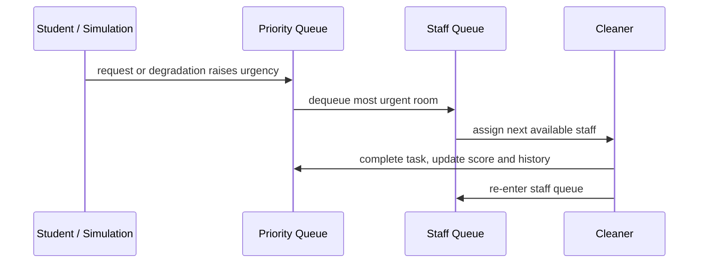

# 🧹 Smart Hostel Cleaning & Resource Optimization System

A web application that applies **Data Structures & Algorithms (DSA)** to a real campus problem: keeping a hostel clean with limited staff. It schedules work by urgency, plans cleaning routes over a room graph, assigns staff fairly, and predicts which rooms will need attention next.


## 📑 Table of Contents

- [Project Overview](#-project-overview)
- [Quick Start](#-quick-start)
- [Core DSA Implementations](#-core-dsa-implementations)
- [Features](#-features)
- [Architecture](#-architecture)
- [Project Structure](#-project-structure)
- [Complexity Analysis](#-complexity-analysis)
- [Design Notes & Limitations](#-design-notes--limitations)
- [Data Persistence](#-data-persistence)
- [How to Use](#-how-to-use)
- [Testing](#-testing)
- [Educational Value](#-educational-value)
- [Roadmap](#-roadmap)
- [Contributing](#-contributing)

## 🎯 Project Overview

The simulated hostel has:

| Item | Value |
|------|-------|
| Rooms | **32**, across **4 floors** (8 per floor) |
| Staff | **6** cleaners |
| Scheduling | Urgency-based, highest score first |
| Routing | Graph traversal over adjacent rooms |
| Analytics | Historical data drives predictive maintenance |

## ⚡ Quick Start

```bash
pnpm install     # install dependencies
pnpm dev         # start the dev server
pnpm build       # production build
```

Open the app, dismiss the welcome dialog, and turn on **Auto-Simulation** on the Dashboard to watch the system run on its own.

## 🔧 Core DSA Implementations

All structures live in `src/app/utils/data-structures.ts`.

### 1. Priority Queue (Max Heap)

A binary max heap that orders cleaning tasks by urgency.

```text
urgency = (100 − cleanlinessScore)
        + (hoursSinceLastCleaned × 2)
        + (occupied ? 20 : 0)
        + (studentRequest ? 30 : 0)
```

**Worked example**

| Room | Clean score | Hours since clean | Occupied | Request | Urgency |
|------|-------------|-------------------|----------|---------|---------|
| 204 | 40 | 10 | yes | yes | 60 + 20 + 20 + 30 = **130** |
| 117 | 85 | 2 | no | no | 15 + 4 = **19** |

Room 204 is dequeued first.

| Operation | Time |
|-----------|------|
| `enqueue(item, priority)` | O(log n) |
| `dequeue()` | O(log n) |
| `peek()` | O(1) |

**Real-world use:** automatically surfaces the rooms that are dirtiest, occupied, or requested by students.

### 2. Graph

Rooms are nodes; horizontal and vertical neighbours are edges.

- Adjacency-list representation
- Undirected, unweighted
- Each node carries room metadata (cleanliness, occupancy, last cleaned)

### 3. BFS: Cleaning Path

`RoomGraph.bfsCleaningPath(startRoom, maxRooms)` expands outward from a starting room and collects nearby dirty rooms, so a cleaner finishes one neighbourhood before walking elsewhere.

```typescript
const path = roomGraph.bfsCleaningPath('101', 8);
// → ['101', '102', '201', '202', ...]
```

**Complexity:** O(V + E). **Use case:** reduce walking distance by grouping nearby dirty rooms.

> BFS visits rooms nearest-first. That is a good, cheap *heuristic* for a route, not a provably shortest tour (that would be a Travelling-Salesman-style problem).

### 4. Dijkstra: Shortest Path

`RoomGraph.dijkstraPath(from, to)` returns the shortest path between any two rooms.

**Complexity:** O((V + E) log V). **Use case:** estimate travel time for emergency requests.

> With every edge weighing 1, Dijkstra gives the same answer as BFS. It becomes worthwhile once edges carry real costs, e.g. a higher weight for stairs or lift waits between floors.

### 5. FIFO Queue: Staff Assignment

Staff are assigned in the order they become free and re-enter the queue after finishing. This guarantees fair workload distribution. Enqueue and dequeue are O(1).

### 6. HashMap: Cleaning History

`CleaningHistoryMap` stores a `Map<roomId, CleaningHistoryEntry[]>`.

| Method | Purpose |
|--------|---------|
| `getAverageCleanlinessScore()` | Historical average per room |
| `getDegradationRate()` | Score drop per day |
| `getCleaningFrequency()` | Cleanings per time period |

## 🚀 Features

| Area | What it does |
|------|--------------|
| **Real-time dashboard** | Live priority queue, staff availability, system stats (average cleanliness, pending tasks), auto-simulation |
| **Room graph** | Colour-coded rooms (🟢 clean · 🟡 moderate · 🔴 dirty), interactive selection, BFS path overlay, floor-wise grid |
| **Student requests** | Request a specific room; gives it a +30 urgency boost and updates the queue immediately |
| **Staff view** | Complete tasks, QR-code verification, per-person performance (tasks completed, efficiency) |
| **Analytics** | Floor-wise statistics, cleaning trends, cleanliness distribution (pie chart), most-cleaned rooms |
| **Predictive analysis** | Flags high-risk rooms from degradation rate and recommends pre-emptive cleaning |
| **Auto-simulation** | Runs assignments, completions, requests and degradation on its own; slow / normal / fast speeds |

## 🏗️ Architecture



**Task lifecycle**



## 📁 Project Structure

```text
src/
├── app/
│   ├── components/
│   │   ├── Dashboard.tsx           # Main dashboard
│   │   ├── RoomGraph.tsx           # Graph visualization
│   │   ├── StudentRequest.tsx      # Student interface
│   │   ├── StaffView.tsx           # Staff interface
│   │   ├── Analytics.tsx           # Analytics & charts
│   │   ├── QuickGuide.tsx          # User guide
│   │   ├── SimulationControls.tsx  # Auto-simulation
│   │   ├── Layout.tsx              # App layout
│   │   └── WelcomeDialog.tsx       # Welcome screen
│   ├── context/
│   │   └── HostelContext.tsx       # State management
│   ├── utils/
│   │   ├── data-structures.ts      # Core DSA implementations
│   │   ├── storage.ts              # LocalStorage persistence
│   │   └── mock-data.ts            # Data generation
│   ├── routes.tsx                  # React Router config
│   └── App.tsx                     # Entry point
```

## 📊 Complexity Analysis

*V = rooms, E = edges, k = history entries, n = queued tasks*

| Operation | Time | Space |
|-----------|------|-------|
| Priority queue insert | O(log n) | O(1) |
| Priority queue extract | O(log n) | O(1) |
| BFS traversal | O(V + E) | O(V) |
| Dijkstra path | O((V + E) log V) | O(V) |
| Staff queue assign | O(1) | O(1) |
| History lookup | O(1) | O(1) |
| Degradation calculation | O(k) | O(1) |

## 🧭 Design Notes & Limitations

Worth knowing, and good discussion points for a viva or review:

- **Stale priorities.** Urgency grows with time (`hoursSinceLastCleaned × 2`), but a heap only orders items by the priority they had when inserted. Recompute and re-heapify periodically (O(n) with a bottom-up build), or recompute on each simulation tick, so old entries don't hide behind newer ones.
- **Greedy routing.** BFS ordering is a heuristic; see the note above.
- **Fairness vs. urgency.** The FIFO staff queue ignores skill, location and current workload. Assigning the *nearest* free cleaner (via Dijkstra) would cut walking time at some cost to strict fairness.
- **Client-side only.** Everything runs in the browser with LocalStorage. There is no authentication, no multi-user sync, and storage is limited to roughly 5 MB per origin.
- **QR verification is a demo.** It proves the workflow, not security. A real deployment needs signed, expiring tokens checked by a server.
- **Predictions are simple.** The degradation rate is a linear average over history, not a trained model.

## 💾 Data Persistence

Everything is stored in **LocalStorage** and survives page refreshes:

- Room states (cleanliness scores, last cleaned)
- Staff information (tasks completed, efficiency)
- Complete cleaning history

To reset the demo, clear the site's storage in your browser's developer tools.

## 🎮 How to Use

1. **Dashboard:** view the live priority queue and staff availability. Click **Assign Task** to assign manually, or enable simulation mode.
2. **Room Graph:** click a room to see its details and adjacency, and the BFS cleaning path from it. Green = clean, yellow = moderate, red = dirty.
3. **Student Request:** enter a room number (or click it in the grid) and submit for a +30 urgency boost. Active requests are listed below.
4. **Staff View:** pick a staff member and room, set the new cleanliness score (60–100), enter the duration, and complete the task. Scanning a QR code for verification is optional.
5. **Analytics:** explore trends, distribution and history; check predictive analysis for high-risk rooms and floor-wise statistics.

## 🧪 Testing

The algorithms are pure functions and classes, so they are easy to unit test (for example with Vitest). Suggested cases:

- Heap returns items in descending priority, including ties and after interleaved enqueue/dequeue
- `bfsCleaningPath` respects `maxRooms` and never returns a room twice
- `dijkstraPath` matches BFS distance on the unweighted graph
- `getDegradationRate` returns 0 for rooms with fewer than two history entries
- Staff queue preserves order after repeated assign/complete cycles

## 🎓 Educational Value

1. **Priority queues** optimise task scheduling under limited resources
2. **Graph algorithms** minimise travel distance and optimise routing
3. **FIFO queues** guarantee fairness in workload distribution
4. **HashMaps** give O(1) data retrieval for analytics
5. **Time complexity** matters in real-time systems
6. **Space-time trade-offs** between caching and recalculation

## 🛠️ Tech Stack

React 18 · TypeScript · React Router 7 · Recharts · Tailwind CSS v4 · Radix UI · QRCode · Sonner

## 🔮 Roadmap

- [ ] A\* search with a floor-distance heuristic
- [ ] Minimum spanning tree for optimal floor coverage
- [ ] Dynamic programming for schedule optimisation
- [ ] Weighted edges (stairs, lifts) so Dijkstra beats BFS
- [ ] Periodic re-heapify to fix stale priorities
- [ ] Machine-learning degradation forecasts
- [ ] Real-time collaboration with WebSockets
- [ ] Nearest-available-staff assignment mode

## 🤝 Contributing

This is an educational project. Contributions welcome:

- Add new algorithms (A\*, MST, DP)
- Improve visualisations
- Add analytics features
- Enhance the simulation

For algorithm details, see [`/DSA_DOCUMENTATION.md`](./DSA_DOCUMENTATION.md).

## 📄 License

MIT License. Free to use for educational purposes.

---

**Built to demonstrate practical DSA applications in real-world systems.**
